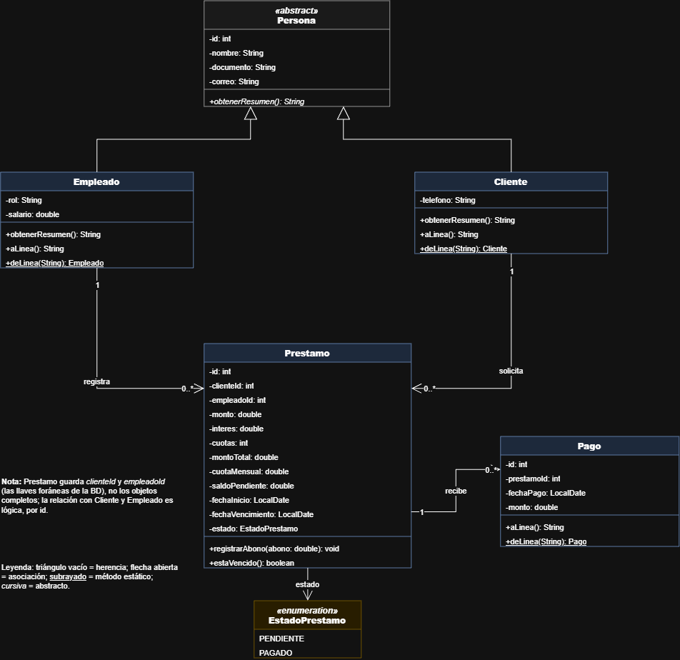
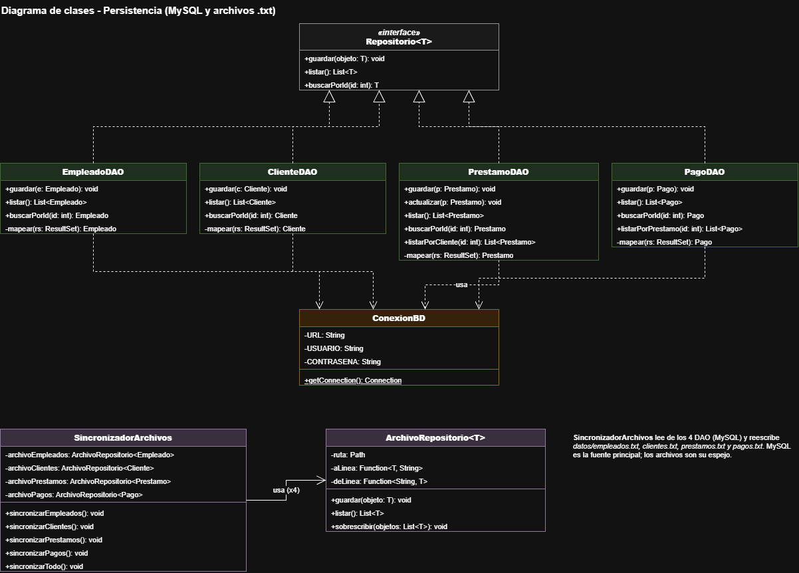
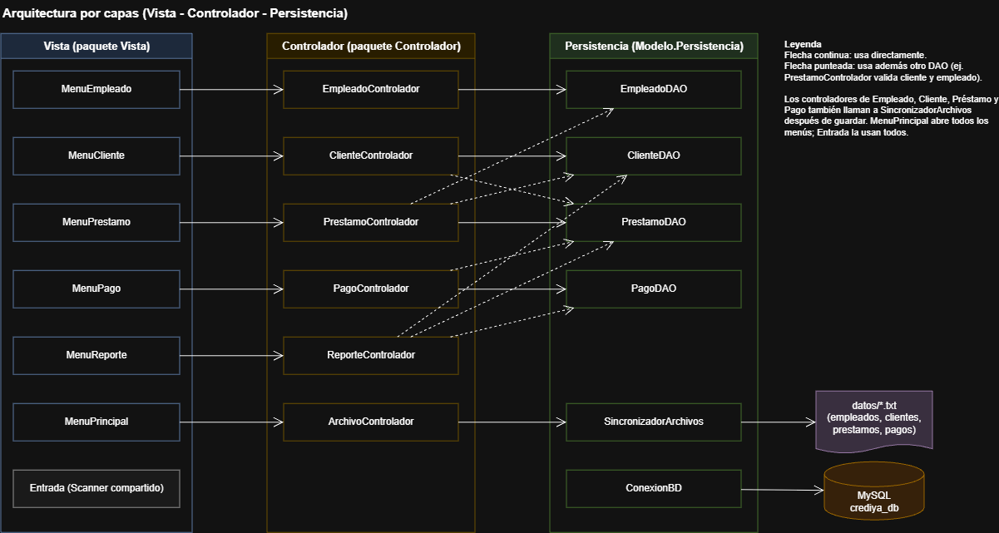

# CrediYa S.A.S. - Sistema de gestión de préstamos y cobros

Sistema de consola en Java para digitalizar el control de préstamos personales de **CrediYa S.A.S.**, que antes manejaba su información en hojas de cálculo. Permite gestionar empleados, clientes, préstamos y pagos, y consultar reportes de cartera. La información se guarda en **MySQL (JDBC)** y se refleja en **archivos de texto**.

> **Autor:** Daniel José Sierra Ricaurte

---

## Contenido

1. [Características](#características)
2. [Tecnologías](#tecnologías)
3. [Requisitos](#requisitos)
4. [Estructura del proyecto](#estructura-del-proyecto)
5. [Instalación y configuración](#instalación-y-configuración)
6. [Ejecución](#ejecución)
7. [Guía de uso con ejemplos](#guía-de-uso-con-ejemplos)
8. [Reglas de negocio](#reglas-de-negocio)
9. [Persistencia: MySQL y archivos de texto](#persistencia-mysql-y-archivos-de-texto)
10. [Diseño y buenas prácticas](#diseño-y-buenas-prácticas)
11. [Diagramas UML](#diagramas-uml)

---

## Características

| Módulo | Funcionalidades |
|---|---|
| **Empleados** | Registrar y listar empleados (id, nombre, documento, rol, correo, salario). El rol se elige de una lista. |
| **Clientes** | Registrar y listar clientes (id, nombre, documento, correo, teléfono) y consultar los préstamos de un cliente. |
| **Préstamos** | Crear préstamos asociando cliente y empleado, con cálculo automático del monto total, la cuota mensual y la fecha de vencimiento. Consultar, listar y cambiar el estado (pendiente / pagado). |
| **Pagos** | Registrar abonos, actualizar el saldo pendiente automáticamente y consultar el histórico de pagos de un préstamo. |
| **Reportes** | Préstamos activos y vencidos, clientes morosos, resumen de cartera, préstamos por empleado y cliente con mayor deuda, todos con **lambdas y Stream API**. |
| **Archivos** | Los datos se reflejan en `empleados.txt`, `clientes.txt`, `prestamos.txt` y `pagos.txt`. |

Todos los datos se validan **campo por campo** mientras se escriben: si un dato es inválido, el programa lo pide de nuevo sin perder lo anterior.

## Tecnologías

- **Java** (JDK 17 o superior; desarrollado con [versión de tu JDK])
- **Maven** para dependencias
- **MySQL 8** como base de datos
- **JDBC** con `mysql-connector-j`
- **IntelliJ IDEA** como entorno de desarrollo

## Requisitos

- JDK 17 o superior instalado.
- MySQL 8 en ejecución (por defecto en `localhost:3306`).
- Maven (incluido en IntelliJ IDEA).
- Un usuario de MySQL con permisos para crear bases de datos.

## Estructura del proyecto

```
Proyecto-Crediya
├── datos/                          Archivos de texto generados
│   ├── empleados.txt
│   ├── clientes.txt
│   ├── prestamos.txt
│   └── pagos.txt
├── docs/                           Diagramas UML y capturas
├── sql/
│   ├── crediya_schema.sql          Estructura de la base de datos
│   └── crediya_datos_ejemplo.sql   Datos de prueba
├── src/main
│   ├── java
│   │   ├── Main.java               Punto de entrada
│   │   ├── Controlador/            Reglas de negocio (una clase por módulo)
│   │   ├── Modelo
│   │   │   ├── Clases/             Persona, Empleado, Cliente, Prestamo, Pago, EstadoPrestamo
│   │   │   ├── Excepciones/        Excepciones propias
│   │   │   └── Persistencia/       ConexionBD, Repositorio<T>, DAO, ArchivoRepositorio, SincronizadorArchivos
│   │   └── Vista/                  Menús de consola y lectura de datos
│   └── resources
│       └── config.properties.example
├── .gitignore
└── pom.xml
```

El proyecto sigue el patrón **MVC** con el flujo `Vista → Controlador → DAO → Base de datos`.

## Instalación y configuración

### 1. Clonar el repositorio

```bash
git clone [URL-de-tu-repositorio]
cd Proyecto-Crediya
```

### 2. Crear la base de datos

Abre MySQL Workbench (o la consola de MySQL) y ejecuta, **en este orden**:

1. `sql/crediya_schema.sql`: crea la base `crediya_db` y sus cuatro tablas.
2. `sql/crediya_datos_ejemplo.sql` *(opcional)*: carga empleados, clientes, préstamos y pagos de ejemplo.

> **Advertencia:** `crediya_schema.sql` borra la base `crediya_db` si ya existe.

### 3. Configurar la conexión

La contraseña **no está en el código**. Se lee de un archivo que Git ignora:

1. Entra a `src/main/resources/`.
2. Copia `config.properties` y nómbralo `config.properties`.
3. Edita los valores con tus datos:

```properties
db.url=jdbc:mysql://localhost:3306/crediya_db
db.usuario=root
db.contrasena=TU_CONTRASEÑA
```

### 4. Descargar dependencias

En IntelliJ: clic derecho sobre el proyecto → **Maven → Reload project**.

## Ejecución

1. Abre el proyecto en IntelliJ IDEA.
2. Verifica que `config.properties` exista y que MySQL esté encendido.
3. Ejecuta la clase `Main` (clic derecho → **Run 'Main'**).

Si aparece el mensaje *"No se encontró config.properties"*, haz **Build → Rebuild Project**.

> La clase `Vista/Pruebas.java` es un recurso de pruebas manuales: **inserta datos** en la base cada vez que se ejecuta. No es el punto de entrada del programa.

## Guía de uso con ejemplos

### Menú principal

```
===== CREDIYA S.A.S. =====
1. Empleados
2. Clientes
3. Préstamos
4. Pagos
5. Reportes
6. Actualizar archivos de texto
0. Salir
```

> *[Inserta aquí una captura del menú principal: `docs/captura-menu.png`]*

### Registrar un empleado

```
-- Registrar empleado --
Nombre:
Error: El nombre es obligatorio.
Nombre: Ana Pérez
Documento: 1001001
Correo: ana@crediya.com
Rol:
  1. Asesor
  2. Cobrador
  3. Cajero
  4. Analista
  5. Administrador
Elija el rol: 1
Salario: 2500000
Empleado registrado con id 1.
```

Si un campo es inválido, solo se vuelve a pedir ese campo.

### Crear un préstamo

```
-- Crear préstamo (escriba 0 en un id para cancelar) --
Id del cliente: 1
Id del empleado: 1
Monto: 1000000
Interés total en % (ej. 10): 10
Número de cuotas (meses): 5
Préstamo creado con id 1.

  Monto prestado:  $1,000,000.00
  Interés:         10.00%
  Total a pagar:   $1,100,000.00
  Cuota mensual:   $220,000.00  (5 cuotas)
  Saldo pendiente: $1,100,000.00
  Estado: PENDIENTE
```

### Registrar un pago

```
Id del préstamo: 1
Saldo pendiente: $1,100,000.00   Cuota mensual: $220,000.00
Monto del abono: 220000
Pago registrado con id 1.
Saldo restante: $880,000.00
```

El sistema rechaza abonos menores o iguales a cero, abonos mayores al saldo y pagos a préstamos que ya están pagados.

> *[Inserta aquí capturas de los demás módulos: `docs/captura-prestamo.png`, `docs/captura-pago.png`, `docs/captura-reportes.png`]*

### Reportes

Con los datos de ejemplo (`crediya_datos_ejemplo.sql`), los reportes muestran:

| Reporte | Resultado esperado |
|---|---|
| Préstamos activos | Préstamos 1, 2, 3 y 5 |
| Préstamos vencidos | Préstamo 3 |
| Clientes morosos | Pedro Díaz |
| Cliente con mayor deuda | Carlos Gómez ($3,040,000) |
| Total prestado | $4,400,000 |
| Total recaudado | $1,135,000 |
| Préstamos por empleado | Ana Pérez: 3, Luis Martínez: 2 |

## Reglas de negocio

| Concepto | Regla |
|---|---|
| Monto total | `monto + (monto × interés / 100)`. El interés es un porcentaje **total**, no mensual. |
| Cuota mensual | `montoTotal / cuotas` |
| Fecha de vencimiento | `fechaInicio + cuotas meses` |
| Saldo pendiente | `montoTotal − suma de abonos`. Al llegar a 0, el estado pasa a `PAGADO`. |
| Préstamo vencido | Estado `PENDIENTE` y fecha de vencimiento anterior a hoy. |
| Cliente moroso | Cliente con al menos un préstamo vencido. |
| Abono válido | Mayor que cero y no superior al saldo pendiente. |
| Campos opcionales | El correo (empleados y clientes) y el teléfono (clientes). Si quedan vacíos se guardan como `NULL`. |
| Documento | Único por empleado y por cliente. |

## Persistencia: MySQL y archivos de texto

**MySQL es la fuente principal de datos.** Los archivos de texto son un **espejo**: cada vez que se registra o modifica un dato, el archivo correspondiente se reescribe por completo desde la base de datos. Así archivo y base nunca quedan desincronizados, y `prestamos.txt` siempre muestra el saldo real.

| Archivo | Se actualiza cuando... |
|---|---|
| `datos/empleados.txt` | Se registra un empleado |
| `datos/clientes.txt` | Se registra un cliente |
| `datos/prestamos.txt` | Se crea un préstamo, se cambia su estado o se registra un pago |
| `datos/pagos.txt` | Se registra un pago |

Formato: un registro por línea, con los campos separados por `;`. Ejemplo de `empleados.txt`:

```
1;Ana Pérez;1001001;ana@crediya.com;Asesor;2500000.0
3;Marta Rojas;1001003;;Cajero;1800000.0
```

Un campo vacío entre `;;` representa un dato opcional sin valor (`NULL`).

La opción **6 del menú principal** regenera los cuatro archivos desde la base de datos. Es útil después de cargar los datos de ejemplo o de limpiar las tablas.

## Diseño y buenas prácticas

**Programación orientada a objetos**
- **Herencia:** `Persona` (abstracta) es la clase base de `Empleado` y `Cliente`.
- **Polimorfismo:** `obtenerResumen()` es abstracto en `Persona` y cada hija lo implementa a su manera.
- **Encapsulamiento:** atributos privados con getters y setters.

**Principios SOLID**
- **Responsabilidad única:** cada DAO atiende una tabla, cada controlador un módulo, y la Vista no contiene lógica de negocio.
- **Inversión de dependencias:** la interfaz genérica `Repositorio<T>` define el contrato común de los DAO.

**Patrones y técnicas**
- **MVC** para separar Vista, Controlador y Modelo.
- **DAO** (*Data Access Object*) para el acceso a MySQL.
- **Genéricos y lambdas** en `ArchivoRepositorio<T>`, que recibe las funciones de conversión de objeto a línea de texto.
- **Stream API** en `ReporteControlador`: `filter`, `map`, `collect`, `mapToDouble`, `groupingBy`, `toMap` y `Optional`, sin ciclos `for`.

**Manejo de excepciones**
- `DatoInvalidoException`: campos vacíos o valores fuera de rango.
- `RegistroNoEncontradoException`: cliente, empleado o préstamo inexistente.
- `PagoInvalidoException`: abono inválido o préstamo ya pagado.
- `PersistenciaException`: errores de MySQL o de archivos; los controladores convierten `SQLException` e `IOException` en esta excepción para que la Vista nunca vea detalles técnicos.

**Seguridad**
- Consultas con `PreparedStatement` para evitar inyección SQL.
- Credenciales fuera del código (`config.properties` está en `.gitignore`).
- Los controladores validan por su cuenta, sin confiar en que la Vista ya validó.

## Diagramas UML

Archivo editable: [`docs/CrediYa-UML.drawio`](docs/CrediYa-UML.drawio) (abrir con [app.diagrams.net](https://app.diagrams.net)).

**Modelo (dominio)**



**Persistencia (DAO y archivos)**



**Arquitectura por capas**



